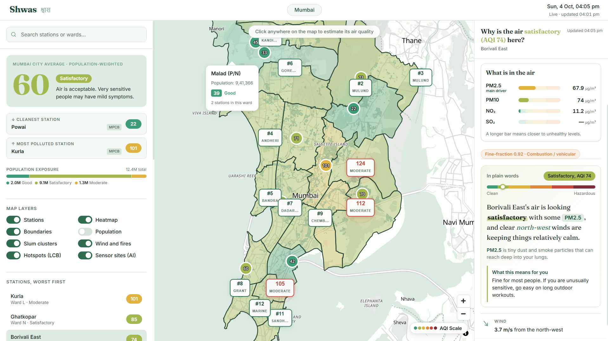

# Shwas (श्वास)

**Demo Video:** [https://youtu.be/HnIcfabFJKQ](https://youtu.be/HnIcfabFJKQ)

**Executive Spatio-Temporal Air Quality Intelligence and Municipal Action Platform for Greater Mumbai**



*Live municipal command platform: 24-ward administrative choropleth, confidence-gated pollution hotspots, optimal sensor placement, kinematic air mass back-trajectories, the Executive Ward Action Center with multilingual LLM operational reasoning, and an interactive Crisis Simulation Engine for preparedness exercises.*

Shwas is an end-to-end spatio-temporal air quality intelligence, causal attribution, and municipal intervention platform engineered for dense urban environments, operationalized across the 24 administrative wards of Greater Mumbai.

## The Core Challenges

1. **Spatial Sparsity Across Urban Wards:** Continuous Ambient Air Quality Monitoring Stations (CAAQMS) are spaced 5 to 15 km apart across Mumbai. Many administrative wards and high-density residential neighborhoods lack on-site monitoring stations.
2. **Temporal Non-Stationarity and Coastal Micro-Climates:** Diurnal sea-breeze circulations, land-breeze reversals, boundary-layer stagnation, and rush-hour vehicular surges introduce severe non-linearities that standard time-series techniques fail to capture.
3. **The Causal Attribution Deficit:** Raw ambient sensor readings (such as "PM2.5: 142 µg/m³") provide no context regarding source origin. Municipal authorities cannot determine whether pollution is driven by vehicular exhaust, road dust, construction activity, industrial emissions, refuse burning, or stagnant atmospheric inversion.
4. **The Municipal Actionability Gap:** Environmental monitoring platforms frequently present passive retrospective charts without actionable operational recommendations. Municipal corporations require clear, automated, ward-specific directives detailing when and where interventions should occur.

Shwas bridges these gaps by unifying **Graph Attention Network (GNN) spatial interpolation**, **weather-aware rolling SARIMAX forecasting**, **kinematic air mass back-trajectory modeling**, **satellite thermal detection of waste and biomass burning**, **confidence-gated DBSCAN hotspot clustering**, **entropy-driven optimal sensor siting**, and an **Executive Ward Action Center** powered by deterministic rules and Gemini 2.5 Flash operational reasoning — with a **multilingual interface and interactive Crisis Simulation Engine** for municipal preparedness exercises.

## System Architecture

```
                          [ Continuous Telemetry and Meteorological Ingestion ]
    ├── High-resolution ambient sensor network telemetry across Mumbai
    ├── Hourly ERA5 numerical weather fields: boundary layer dynamics, wind vectors, humidity
    ├── NASA FIRMS VIIRS active satellite thermal anomaly feeds (MODIS and VIIRS SNPP)
    └── Physical bounds validation, negative concentration rejection, and sensor drift filtering
                                     │
                                     ▼
        ┌────────────────────────────┴─────────────────────────────┐
        ▼                                                          ▼
 [ Spatial Modeling Engine ]                              [ Temporal Forecasting Engine ]
  ├── Spatial GNN (Graph Attention Network)                ├── Rolling SARIMA (1,0,1)(1,0,0)24
  ├── Distance-weighted k-NN topology (k = 5)              ├── SARIMAX (+5 hourly weather regressors)
  └── 22.7% lower MAE than IDW baseline                    └── 14.0% lower MAE than plain SARIMA
        │                                                          │
        └────────────────────────────┬─────────────────────────────┘
                                     ▼
                  [ Chained Spatio-Temporal Predictor ]
                    ├── Station-level forward forecasts generated via SARIMAX (24 h horizon)
                    ├── Propagates predicted station states through Spatial GNN forward pass
                    └── Yields high-precision 24-hour predictive trajectories at any coordinate
                                     │
                                     ▼
                  [ Rigorous Uncertainty Quantification ]
                    ├── Analytical confidence intervals via SARIMAX parameter covariance
                    └── Epistemic variance estimation via Monte Carlo dropout forward passes
                                     │
        ┌────────────────────────────┴─────────────────────────────┐
        ▼                                                          ▼
 [ Attribution and Kinematic Physics ]                   [ Spatial Analytics and Siting ]
  ├── Eulerian-Lagrangian air mass back-trajectories       ├── Mumbai bounding box grid scan (2 km resolution)
  ├── VIIRS and MODIS thermal anomaly cluster detection    ├── Statistically gated DBSCAN hotspot clusters
  ├── Fine-fraction particle ratio source partitioning     ├── Greedy spatial entropy sensor placement
  ├── Open-Meteo batch multi-location wind ingestion       └── Population exposure ranking across 24 BMC wards
  └── Upwind transboundary transport verification
        │                                                          │
        └────────────────────────────┬─────────────────────────────┘
                                     ▼
                  [ Executive Ward Action Center Engine ]
                    ├── Multi-signal rule evaluation matrix across all 24 administrative wards
                    ├── Gemini 2.5 Flash operational reasoner: English, Hindi, and Marathi output
                    ├── Risk-ranked priority dispatch (0–100 normalized score) with evidence confidence
                    ├── Crisis Simulation Engine: physical WardContext overrides for preparedness drills
                    ├── City-wide alert aggregation feed across all active ward detectors
                    └── On-demand Standard Operational Mitigations modal for BMC protocols
                                     │
                                     ▼
                  [ High-Performance FastAPI REST Backend ]
                                     │
                                     ▼
                  [ Interactive React 19 Municipal Command Center ]
               (Real-time geospatial canvas, predictive time-slider, multilingual operational dashboards)
```

## Mathematical Formulations and Methodologies

### 1. Spatial Graph Attention Network (GNN)
Given target query location $s$ and $n$ ambient monitoring stations, the baseline Inverse Distance Weighting (IDW) estimates:

$$\hat{x}(s)=\frac{\sum_{i=1}^{n} w_i\,x_i}{\sum_{i=1}^{n} w_i},\qquad w_i=\frac{1}{d_i^{\,p}},\quad p=2$$

Where $d_i$ represents the haversine distance. To capture complex non-linear spatial dependencies and urban morphology, Shwas constructs a directed graph $\mathcal{G} = (\mathcal{V}, \mathcal{E})$ comprising the query location and all monitoring stations. Each node is connected to its $k=5$ nearest neighbors with edge weight $w_{ij}=1/(d_{ij}^{2}+\epsilon)$.

Each node carries a feature vector $h_i \in \mathbb{R}^{9}$ encompassing normalized latitude, normalized longitude, current AQI, AQI at $t-1$, AQI at $t-3$, and harmonic temporal encodings $\sin(2\pi t / 24)$, $\cos(2\pi t / 24)$, $\sin(2\pi d / 7)$, and $\cos(2\pi d / 7)$.

The representation is updated through two multi-head attention layers (4 attention heads, hidden dimension 64) biased by geographic proximity:

$$\alpha_{ij}=\frac{w_{ij}\,\exp\!\left(\dfrac{q_i\cdot k_j}{\sqrt{d}}\right)}{\sum_{m\in\mathcal{N}(i)} w_{im}\,\exp\!\left(\dfrac{q_i\cdot k_m}{\sqrt{d}}\right)},\qquad h_i'=\mathrm{LayerNorm}\!\left(W_o\sum_{j\in\mathcal{N}(i)}\alpha_{ij}\,v_j+W_r\,h_i\right)$$

A multi-layer perceptron projection on the query node outputs the estimated index: $\widehat{\mathrm{AQI}}=500\cdot\sigma\!\left(\mathrm{MLP}(h_q)\right)$.

### 2. Epistemic Uncertainty Quantification via Monte Carlo Dropout
To quantify model uncertainty in regions with sparse spatial coverage, dropout is kept active during inference. Over $T=20$ stochastic forward passes $\hat{y}_t$:

$$\mu=\frac{1}{T}\sum_{t=1}^{T}\hat{y}_t,\qquad \sigma=\sqrt{\frac{1}{T}\sum_{t=1}^{T}\left(\hat{y}_t-\mu\right)^{2}}$$

### 3. Weather-Aware Temporal Forecasting (SARIMAX)
Air quality time-series exhibit strong non-stationarity driven by meteorology. Shwas fits station-specific seasonal autoregressive integrated moving average models with exogenous meteorological regressors $x_t$ (ambient temperature, relative humidity, horizontal wind speed, surface atmospheric pressure, and precipitation):

$$y_t=\beta^{\top}x_t+\eta_t,\qquad \phi(B)\,\Phi(B^{24})\,\eta_t=\theta(B)\,\varepsilon_t$$

Where $B$ is the backshift operator, $\phi(B)$ represents the non-seasonal AR polynomial, $\Phi(B^{24})$ is the seasonal AR polynomial with a 24-hour diurnal period, and $\theta(B)$ represents the MA polynomial.

### 4. Zero-Sensor Chained Spatio-Temporal Prediction
To forecast air quality at arbitrary geographic coordinates lacking direct monitoring equipment, Shwas couples the temporal and spatial models. Future station states $\{\hat{y}_s(t+h)\}_{s\in S}$ are generated via SARIMAX across forecast horizon $h \in [1, 24]$ hours, and subsequently passed through the Spatial GNN:

$$\hat{y}_\ell(t+h) = f_{\mathrm{GNN}}\!\left( \left\lbrace \hat{y}_s(t+h) \right\rbrace_{s\in S}, \ell \right)$$

### 5. Kinematic Air Mass Back-Trajectory Analysis
To determine regional transport pathways and identify upwind emission sources, Shwas implements backward parcel advection over horizontal wind vector fields $(u, v)$:

$$\mathbf{x}(t - \Delta t) = \mathbf{x}(t) - \mathbf{v}(\mathbf{x}, t)\,\Delta t$$

Air parcels are tracked backward over 12, 24, and 48-hour horizons. Trajectories are cross-referenced with satellite thermal detections to detect whether incoming air masses traversed active burning clusters prior to reaching municipal ward boundaries. Wind fields are ingested in batch from the Open-Meteo forecast API for all monitoring station coordinates simultaneously, with 30-minute in-process caching per station cell.

### 6. Fine-Fraction Source Apportionment
The ratio of fine particulate matter (PM2.5) to coarse particulate matter (PM10) separates high-temperature combustion emissions from crustal dust:

$$\eta=\frac{[\mathrm{PM}_{2.5}]}{[\mathrm{PM}_{10}]}$$

| Particle Ratio | Dominant Attribution Class | Physical Characteristics |
|:---|:---|:---|
| $\eta \ge 0.65$ | Primary Combustion | Vehicular exhaust, industrial stack emissions, refuse burning |
| $0.40 < \eta < 0.65$ | Mixed Urban Background | Combined mobile and secondary aerosol formation |
| $\eta \le 0.40$ | Crustal and Mechanical Dust | Unpaved roads, construction dust, sea salt spray |

### 7. Confidence-Gated Hotspot Detection
To prevent false municipal alarms caused by spatial variance, a grid cell is classified as an operational hotspot only if its Lower Confidence Bound (LCB) exceeds the intervention threshold (AQI $\ge 100$):

$$\mathrm{LCB}=\mu-z\,\sigma\ \ge\ 100$$

Where $z=1.96$ corresponds to a 95% confidence threshold. Significant cells within 3 km are clustered using Density-Based Spatial Clustering of Applications with Noise (DBSCAN) using haversine metric distance.

### 8. Optimal Sensor Placement Siting Algorithm
Candidate monitoring locations are evaluated using spatial entropy and demographic exposure metrics. Given model uncertainty $\sigma$ and ward population $P$:

$$\mathrm{Score}=\sigma\cdot\log_{10}\!\left(1+P\right)$$

The optimization executes a two-tier greedy allocation: first selecting the highest-scoring site within each unmonitored administrative ward (maintaining at least 1 km distance from existing stations), followed by city-wide ranking with a 2 km spatial separation constraint.

### 9. Population-Weighted Municipal Exposure
City-wide and ward-level health burdens are quantified by weighting ambient concentrations by ward census population $P_w$:

$$\overline{\mathrm{AQI}}_{\mathrm{city}}=\frac{\sum_{w} P_w\,\mathrm{AQI}_w}{\sum_{w} P_w}$$

### 10. Priority Score Normalization
Each triggered action card carries a population-weighted severity score. To yield an interpretable 0–100 operational index, raw exposure scores (severity weight × population × AQI/100) are normalized against the theoretical maximum capacity of the ward:

$$P_{\mathrm{norm}}=\min\!\left(100,\;\frac{\mathrm{score}_{\mathrm{raw}}}{3.0\times P_w\times 5.0}\times 100\right)$$

Where 3.0 is the maximum severity weight, 5.0 represents the normalized AQI ceiling (500/100), and $P_w$ is the ward census population.

## Empirical Validation and Benchmark Results

All models undergo rigorous evaluation on telemetry collected across Greater Mumbai. Error metrics are expressed in standard AQI points.

### 1. Spatial Interpolation: Spatial GNN versus IDW Baseline
Leave-one-station-out cross-validation across the municipal network:

| Metric | Baseline IDW | Spatial GNN (Shwas) | Error Reduction |
|:---|:---:|:---:|:---:|
| Mean Absolute Error (MAE) | 27.47 | **21.24** | **22.7%** |
| Root Mean Square Error (RMSE) | 36.75 | **27.40** | **25.4%** |

### 2. Temporal Forecasting: Rolling SARIMA versus Seasonal Naive
Walk-forward evaluation with rolling 24-hour predictive horizons:

| Station Location | Seasonal Naive Baseline | Rolling SARIMA | Improvement |
|:---|:---:|:---:|:---:|
| Chhatrapati Shivaji Airport (T2) | 4.42 | **3.16** | +1.26 |
| Kurla | 13.52 | **9.16** | +4.36 |
| Powai | 10.35 | **7.57** | +2.78 |
| Sion | 13.92 | **12.02** | +1.90 |
| Worli | 10.38 | **4.73** | +5.65 |
| Borivali East | 18.27 | **12.97** | +5.30 |
| **Network Fleet Average** | **11.81** | **8.27** | **3.54 points gain (100% of stations)** |

Station models fit in 0.10 to 0.25 seconds, enabling continuous rolling adaptation without batch latency.

### 3. Weather-Aware Forecasting: Exogenous Meteorological Regressors
Walk-forward evaluation incorporating five hourly ERA5 meteorological regressors:

| Station Location | Seasonal Naive | Plain SARIMA | SARIMAX (+Weather) | Weather Regressor Gain |
|:---|:---:|:---:|:---:|:---:|
| Chhatrapati Shivaji Airport (T2) | 4.42 | 3.16 | **2.92** | +0.24 |
| Kurla | 13.52 | 9.16 | **7.18** | +1.98 |
| Powai | 10.35 | 7.57 | **6.79** | +0.78 |
| Sion | 13.92 | 12.02 | **8.37** | +3.65 |
| Worli | 10.38 | 4.73 | **4.07** | +0.66 |
| Borivali East | 18.27 | **12.97** | 13.35 | -0.38 |
| **Network Fleet Average** | **11.81** | **8.27** | **7.11** | **14.0% lower error than SARIMA** |

### 4. Zero-Sensor Coordinate Forecasting
Station predictions chained through the Spatial GNN, evaluated via leave-one-station-out backtesting at uninstrumented locations:

| Forecast Horizon | Spatial Baseline (IDW Chain) | Shwas (GNN Chain) | Error Reduction |
|:---:|:---:|:---:|:---:|
| 1 Hour Ahead | 48.5 | **9.0** | **81.4%** |
| 6 Hours Ahead | 50.6 | **9.9** | **80.4%** |
| 12 Hours Ahead | 54.1 | **11.7** | **78.4%** |
| 24 Hours Ahead | 50.6 | **13.5** | **73.3%** |

At a 24-hour predictive horizon without an on-site physical sensor, the chained GNN achieves an MAE of 13.5 AQI points, closely approaching the 10.3 MAE of a direct station-fit model.

## Executive Ward Action Center

The Executive Ward Action Center translates analytical intelligence into prioritized municipal action cards for the Brihanmumbai Municipal Corporation (BMC / MCGM).

### Operational Trigger Matrix
The decision engine evaluates six rule categories across all 24 administrative wards. Rules are declared in a hot-reloadable YAML configuration (`action_rules.yaml`) and the engine picks up edits at runtime without a server restart:

1. **Atmospheric Stagnation Alert:** Triggers when surface wind velocity drops below 1.5 m/s for three consecutive hours and forward forecasts project AQI deterioration exceeding 10 points. Directs early morning anti-smog mist cannon deployment and mechanical street sweeping before peak inversion.
2. **Thermal Waste Burning Alert:** Triggers upon satellite thermal anomaly detection within dumping grounds or open landfill perimeters (e.g., Deonar or Mulund) paired with fine-fraction combustion particle ratios. Dispatches municipal firefighting squads and drone surveillance.
3. **Regional Smoke Inflow Alert:** Triggers when kinematic back-trajectories detect incoming air masses passing through active upwind fire clusters. Recommends ward health advisories and high-capacity air filtration in civic schools and hospitals.
4. **Rapid Deterioration Alert:** Triggers when the temporal forecasting engine projects a 25+ point AQI surge within a 6-hour window. Mandates targeted construction halt orders and traffic signal retiming on major arterial corridors.
5. **Dry Dust Episode Alert:** Triggers when low particle ratios ($\eta \le 0.40$) coincide with elevated wind speeds and dry conditions. Mandates intensive construction site wet-suppression and water sprinkling on major transit routes.
6. **Unmonitored Ward Precautionary Alert:** Evaluates wards lacking physical monitoring stations where GNN spatial interpolation indicates elevated exposure. Dispatches mobile monitoring units and targeted enforcement.

Each triggered card carries a **normalized priority score (0–100)**, calculated from severity weight, live ward AQI, and census population, providing field officers with a ranked dispatch order.

### LLM Operational Reasoner
Integrated with Gemini 2.5 Flash, the reasoner ingests live atmospheric dynamics, multi-sensor telemetry, wind vectors, and municipal SOP protocols to generate detailed executive justifications. Output is available in **English, Hindi (हिंदी), and Marathi (मराठी)** — the active language is selected by the user in the dashboard and propagated through every API call so reasoning is generated natively in the chosen language. Each operational card provides municipal officers with:
- **Operational Directive:** Immediate, concrete physical action with exact operational execution windows.
- **Why This Action (Synthesized Reasoning):** Multi-factor analysis explaining the atmospheric and environmental drivers necessitating intervention.
- **Empirical Evidence Base:** Quantitative telemetry records, wind velocities, stagnation durations, and projected index delta.
- **Operational Guidance:** Sequential enforcement steps for ward field teams.
- **Pre-Intervention Forecast Trajectory:** 12-hour baseline projection illustrating anticipated air quality trajectory in the absence of intervention.

Reasoning is cached per ward and language for five minutes, ensuring instant re-access without redundant API calls, while language switches trigger immediate re-generation in the selected language.

### Crisis Simulation Engine
The Crisis Simulation Engine allows municipal planners to run preparedness exercises against physically grounded crisis scenarios without affecting live monitoring data. Each simulation applies deterministic overrides to a live `WardContext` cloned from real telemetry, then passes it through the full action rule evaluation pipeline:

| Scenario | Ward | Physical Overrides Applied |
|:---|:---|:---|
| **Deonar Landfill Firestorm** | M/E (Govandi, Mankhurd, Deonar) | NASA VIIRS thermal anomaly injected at landfill perimeter; AQI elevated by crisis delta |
| **Winter Coastal Inversion** | H/E (Bandra East, Santacruz East, BKC) | Wind speed reduced to < 1.5 m/s for 3 hours; 6-hour forecast delta injected |
| **Kurla C&D Dust Surge** | L (Kurla, Chunabhatti, Saki Naka) | Fine-fraction ratio forced to 0.28; PM10 ratio elevated; dry humidity conditions applied |

The simulation response returns the same schema as the live `/api/actions` endpoint — including before/after AQI delta, baseline versus simulated priority scores (0–100), and a full set of generated action cards — enabling direct comparison without any divergence from the production rule engine.

### City-Wide Alert Feed
A consolidated city-level alert aggregation view surfaces active action cards from all 24 wards simultaneously, ranked by normalized priority score. Ward officers can identify the highest-risk locations across the entire network in a single view and navigate directly to the ward detail from the feed.

### Ward Analytical Panels
The ward detail view includes three live analytical panels rendered from real telemetry:

- **12-Hour AQI Forecast Chart:** Recharts area chart plotting the current AQI alongside the model's 12-hour predictive trajectory, annotated with AQI band color zones.
- **24-Ward Exposure Bubble Map:** Pure-SVG ranked bubble visualization of all 24 BMC wards, scaled by live AQI and colored by category, enabling instant network-wide situational awareness.
- **Exposure Comparison Bar:** Horizontal bar comparing the selected ward's AQI against the live city-wide population-weighted median.

### Standard Operational Mitigations Modal
City-wide standing operational procedures (BMC / MCGM SOPs) are decoupled from ephemeral live detections and accessible via an on-demand modal. This ensures ward executive officers maintain instant reference to permanent municipal protocols including construction site dust containment, daily mechanical sweeping schedules, and arterial corridor misting.

## Interactive Municipal Web Application

Engineered with **React 19**, **Vite**, and **MapLibre GL** for responsive municipal command:

- **Multilingual Interface:** Full English, Hindi, and Marathi localization across the entire application — navigation labels, action cards, ward statistics, scenario descriptions, and Gemini-generated reasoning all render in the selected language. Language preference is persisted across sessions.
- **24-Ward Administrative Choropleth:** Color-coded ward boundaries displaying real-time population exposure, air quality categories, and active monitoring density.
- **Interpolated Spatial Heatmap:** High-resolution continuous spatial surface clipped to municipal boundaries.
- **Predictive Horizon Slider:** Time-travel slider allowing operators to visualize anticipated spatial dispersion up to 24 hours into the future.
- **Kinematic Back-Trajectory Canvas:** Visual vector paths illustrating air parcel origin points over 12, 24, and 48-hour periods.
- **Thermal Fire Overlay:** Satellite thermal hotspots with distance-decay radii and upwind trajectory intersections.
- **Arbitrary Point Query:** Interactive map inspection allowing users to query any geographic coordinate for instantaneous GNN estimation and uncertainty bounds.
- **Optimal Sensor Placement Layer:** Visualizes top-ranked candidate sites for new monitoring hardware, prioritized by population coverage and spatial entropy.
- **Ward Action Center with Tabbed Navigation:** Ward detail, city-wide alert feed, and crisis simulator accessible from a unified navigation bar.

## Datasets and Data Sources

| Source | Used for |
|:---|:---|
| [CPCB real-time portal via data.gov.in](https://data.gov.in/) | Hourly PM2.5, PM10, SO2, NO2, CO, O3 and NH3 from Mumbai CAAQMS stations |
| [Air Quality Data in India (Kaggle / CPCB archives)](https://www.kaggle.com/datasets/rohitgr/air-quality-data-in-india) | Historical hourly data for training and walk-forward validation |
| [Open-Meteo](https://open-meteo.com/) | ERA5 reanalysis for training; batch multi-location forecast API for live SARIMAX weather inputs and wind vector ingestion |
| [OpenWeatherMap](https://openweathermap.org/api) | Live surface weather for wind vectors |
| [NASA FIRMS](https://firms.modaps.eosdis.nasa.gov/) | VIIRS SNPP near real-time active fire detections and Fire Radiative Power |
| [OpenStreetMap Overpass](https://overpass-api.de/) | Coastline, waterways and roads for station geographic features |
| [GDELT](https://www.gdeltproject.org/) | News search for local air quality context |
| [Google Gemini](https://ai.google.dev/) | Multilingual operational reasoning summaries (English, Hindi, Marathi) via Gemini 2.5 Flash |
| [Bharatlas](https://bharatlas.com/) and Census of India 2011 | BMC ward boundaries (24 wards) and ward population |


## Repository Structure

```
Shwas/
├── backend/
│   ├── alembic/              Database schema migrations
│   ├── app/
│   │   ├── analytics/        Action engine, LLM reasoner (multilingual), DBSCAN hotspots, sensor placement
│   │   ├── aqi/              Standard ambient sub-index breakpoints
│   │   ├── attribution/      Wind vectors (batch Open-Meteo), satellite thermal fires, back-trajectories, news
│   │   ├── forecasting/      SARIMA, SARIMAX, and chained zero-sensor coordinate models
│   │   ├── ingestion/        Continuous network telemetry and meteorological ingestion
│   │   ├── interpolation/    Spatial GNN inference, IDW baseline, and coordinate lookups
│   │   ├── ml/               PyTorch Graph Attention Network architecture and weights
│   │   ├── models/           SQLAlchemy relational models
│   │   ├── routers/          FastAPI REST API route controllers including Crisis Simulation endpoint
│   │   └── rules/            Hot-reloadable declarative action rules configuration (action_rules.yaml)
│   ├── evaluate/             Cross-validation and model benchmark evaluation runners
│   ├── models/               Pre-trained GNN model checkpoints
│   ├── scripts/              Data preparation and evaluation scripts
│   └── tests/                Unit and integration test suite
├── frontend/
│   ├── src/
│   │   ├── components/       Ward action center, crisis simulator, city feed, charts, interactive maps, modals
│   │   ├── hooks/            Data synchronization and language-aware state management hooks
│   │   ├── i18n/             LangContext, language switcher, and EN / HI / MR translation dictionaries
│   │   ├── utils/            Air mass kinematic calculation, coordinate math, ward data, priority formatting
│   │   └── App.jsx           Root municipal dashboard layout
│   └── package.json          React 19 and frontend dependencies
└── docs/                     Documentation graphics and architecture figures
```

## Quality Assurance and Verification

The repository contains an automated verification suite comprising **359 unit and integration tests** covering:
- Spatial GNN tensor dimensions, attention weighting, and Monte Carlo dropout consistency.
- SARIMAX time-series fitting, exogenous meteorological integration, and rolling walk-forward evaluation.
- Kinematic back-trajectory parcel advection and spatial intersection with satellite thermal anomalies.
- Executive action rule evaluation and Gemini 2.5 Flash prompt generation across all six detector categories.
- Crisis simulation scenario synthesis, physical WardContext override correctness, and before/after delta validation.
- Priority score normalization to the 0–100 range under varying ward population and severity configurations.
- Statistically gated hotspot clustering and greedy sensor placement spatial constraints.
- End-to-end FastAPI endpoint response schemas, language parameter routing, and database transaction safety.
